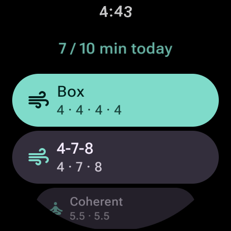
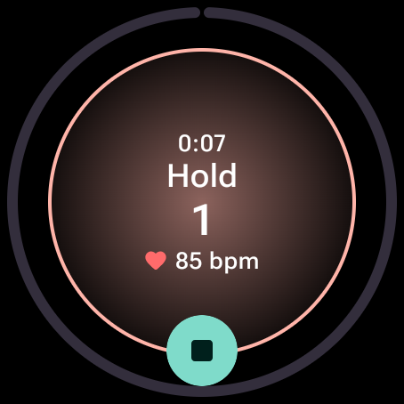
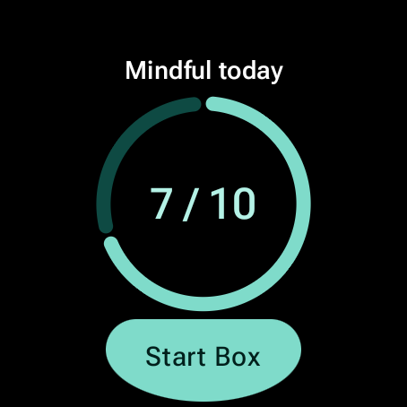
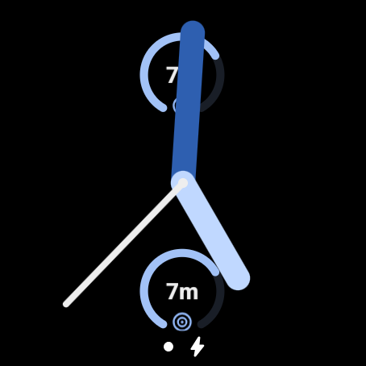
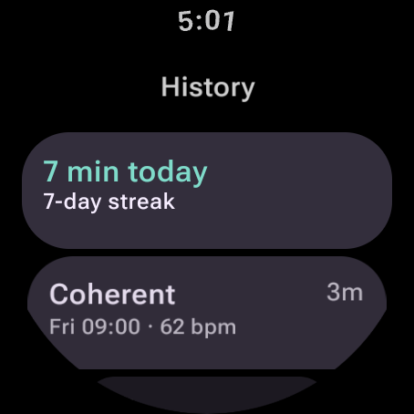
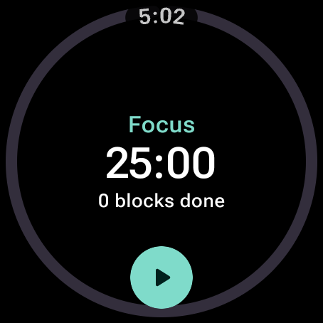
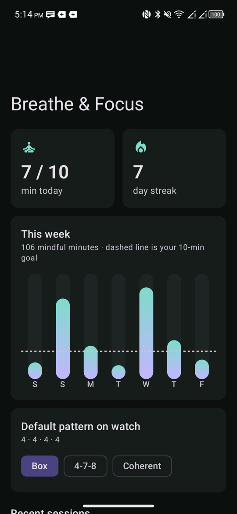
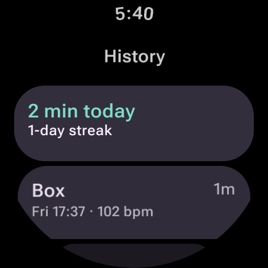
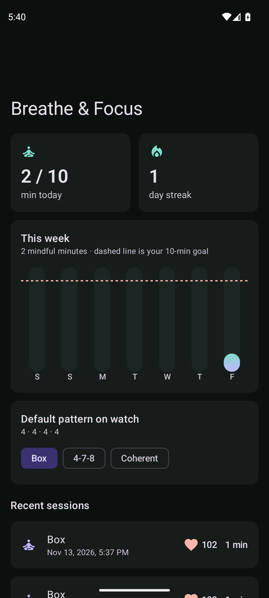
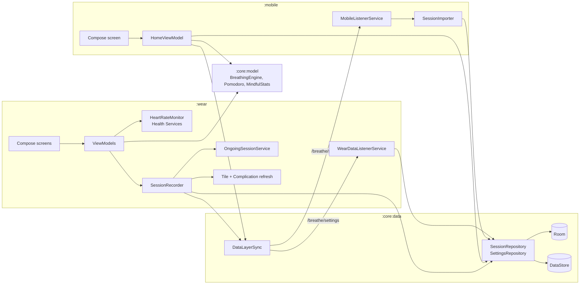

# Breathe & Focus

A Wear OS breathing and focus app with a phone companion. Built as a showcase of modern Wear OS
development: Compose for Wear OS Material 3, Health Services, Tiles, Complications, Ongoing
Activities and the Wearable Data Layer.

<p>
  
  
  
  
</p>
<p>
  
  
  
</p>

Demo recording (59 s, emulator): [docs/demo/breathe-focus-demo.mp4](docs/demo/breathe-focus-demo.mp4).
It shows a session with heart rate, history, the complication, the tile, and the tile's Start button.

## Features

**Watch (`:wear`)**
- Three breathing patterns (Box 4-4-4-4, 4-7-8, Coherent 5.5-5.5) with an animated ring that
  grows and shrinks with each phase, plus a haptic tick at every phase change.
- Live heart rate from Health Services `MeasureClient`. If permission is denied or there is no
  sensor, the session carries on and shows why instead.
- 25-minute Pomodoro focus timer with 5-minute breaks.
- Session history with today's mindful minutes and a day streak.
- Ongoing Activity while a session runs, so it stays one tap away from the watch face.
- ProtoLayout Material 3 tile: progress ring towards a 10-minute daily goal and a Start button
  for the default pattern.
- Complication (short text and ranged value) showing today's mindful minutes.
- Tile and complication refresh whenever a session is saved.

**Phone (`:mobile`)**
- Weekly mindful-minutes chart against the daily goal, today's total and the streak.
- Recent sessions with average heart rate.
- Default-pattern picker that syncs to the watch and its tile.

**Sync**: the watch publishes the last 30 days of sessions as a `DataItem`; the phone publishes
the default pattern. Both sides listen with a `WearableListenerService`.

Sync is verified end to end on a paired Wear OS emulator and phone emulator: a real session
finished on the watch shows up in the phone's recent sessions and chart. The full emulator smoke
(permissions, process-death recovery, focus session, tile) is in [docs/demo/smoke](docs/demo/smoke/README.md).

<p>
  
  
</p>

## Architecture



- **`:core:model`**: plain Kotlin. Breathing timing, Pomodoro state and streak maths are pure
  functions of elapsed time, so they are tested without clocks or coroutines.
- **`:core:data`**: Room for sessions, DataStore for settings, and the Data Layer contract and codec
  shared by both apps.
- **`:wear`** and **`:mobile`**: UDF with `ViewModel` + `StateFlow`, Hilt for DI, Navigation 3 on
  the watch.

## Stack

| Area | Library | Version |
|---|---|---|
| Build | AGP / Gradle / Kotlin / KSP | 9.5.1 / 9.9.1 / 2.4.21 / 2.3.13 |
| SDK | compileSdk / targetSdk, minSdk | 37, wear 30, mobile 28 |
| Watch UI | Wear Compose Material 3, Navigation 3 | 1.7.1, 1.2.1 |
| Phone UI | Compose BOM (Material 3) | 2026.09.00 |
| Tiles | Tiles / ProtoLayout Material 3 | 1.6.2 / 1.4.2 |
| Watch face | Complications data source | 1.3.0 |
| Sensors | Health Services | 1.1.0 |
| Ongoing | Wear Ongoing | 1.1.0 |
| Sync | Play Services Wearable | 20.0.1 |
| Data | Room / DataStore | 2.8.5 / 1.3.0 |
| DI | Hilt | 2.60.1 |
| Tests | JUnit 4, Robolectric, Compose UI test, Turbine | 4.13.2, 4.17, BOM, 1.2.1 |
| Style | ktlint (Gradle plugin), Android lint | 14.2.0 |

All versions live in [`gradle/libs.versions.toml`](gradle/libs.versions.toml).

## Run it

Requirements: Android Studio with JDK 21 and SDK platform 37.

```bash
./gradlew :wear:installDebug      # on a Wear OS emulator or watch (API 30+)
./gradlew :mobile:installDebug    # on a paired phone or phone emulator
```

To pair a phone and watch emulator, use Android Studio's **Wear OS emulator pairing assistant**.

Demo data for screenshots (debug builds only):

```bash
adb shell am broadcast -n com.codebyramiz.breathefocus/com.codebyramiz.breathefocus.wear.demo.DemoSeedReceiver
adb shell am broadcast -n com.codebyramiz.breathefocus/com.codebyramiz.breathefocus.mobile.demo.DemoSeedReceiver
```

On the emulator, heart rate comes from the emulator's synthetic sensor.

## Checks

```bash
./gradlew ktlintCheck test lint assembleDebug
```

These are the same steps CI runs ([`.github/workflows/ci.yml`](.github/workflows/ci.yml)) on a self-hosted runner.
